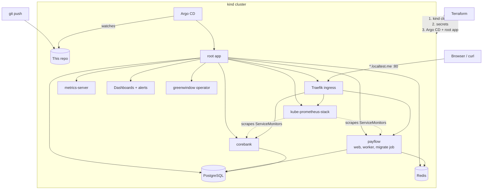

# gitops-platform

A GitOps platform on Kubernetes: Terraform bootstraps a kind cluster and Argo CD deploys everything else from Git.

[](https://github.com/Schaib03/gitops-platform/actions/workflows/ci.yml)


It runs [payflow-api](https://github.com/Schaib03/payflow-api),
[corebank-api](https://github.com/Schaib03/corebank-api) and the
[greenwindow](https://github.com/Schaib03/greenwindow) operator on Kubernetes, the GitOps way.
Terraform creates a local kind cluster and installs Argo CD. From then on, everything in
the cluster (ingress, monitoring, databases, the two apps) is declared in this repository
and kept in sync by Argo CD.

## Architecture



Repository layout:

```
terraform/      kind cluster, generated secrets, Argo CD and the root application
apps/           one Argo CD Application per component (children of the root app)
charts/
  payflow/      web Deployment, Celery worker, migration hook Job, HPA, PDB,
                Ingress, ServiceMonitor, idempotency-key cleanup CronJob
  corebank/     Deployment, HPA, PDB, Ingress, ServiceMonitor
  postgres/     single-instance PostgreSQL, one database per app
  redis/        single-instance Redis (Celery broker)
monitoring/     Grafana dashboard and PrometheusRule alerts (kustomize)
Makefile        up / down / lint / validate / tf-check
```

Sync order is controlled with sync waves on the child Applications:

| Wave | Applications |
| --- | --- |
| -2 | traefik, metrics-server, kube-prometheus-stack |
| -1 | postgres, redis |
| 0 | dashboards |
| 1 | payflow, corebank, greenwindow |

Argo CD is configured with a health check for `Application` resources, so a wave only
starts when the previous one is healthy.

## Running it

Requirements: Docker, Terraform, kubectl, and kind (used by the Terraform provider).
helm and kubeconform are only needed for `make check`. On Windows, run the Makefile from
Git Bash or WSL, or run the commands in it by hand.

```bash
make up
```

This takes a few minutes. Terraform:

1. creates a kind cluster (`kind-platform`) with ports 80 and 443 mapped to the host;
2. generates random passwords and writes them as Kubernetes secrets;
3. installs Argo CD with Helm;
4. creates the root Application, which points at `apps/` in this repository.

Argo CD then installs everything else. Follow it with:

```bash
kubectl -n argocd get applications -w
make passwords
```

| URL | What |
| --- | --- |
| http://argocd.localtest.me | Argo CD (user `admin`) |
| http://grafana.localtest.me | Grafana, dashboard "Platform overview" |
| http://payflow.localtest.me/docs | PayFlow Swagger UI |
| http://corebank.localtest.me/swagger-ui.html | CoreBank Swagger UI |

`localtest.me` is a public DNS name whose subdomains all resolve to 127.0.0.1, so no
`/etc/hosts` change is needed.

Tear down with `make down`.

To try a change: fork the repo, set `repo_url` in `terraform/terraform.tfvars`, push a
change to `charts/` and watch Argo CD apply it. Change something by hand with `kubectl`
and Argo CD puts it back (self-heal).

## Checks

```bash
make check
```

Runs `helm lint --strict` on every chart, renders them with `helm template`, builds the
kustomization, validates everything (including the Argo CD Applications, ServiceMonitors
and PrometheusRules, using the CRD schema catalog) with kubeconform against Kubernetes
1.37, then runs `terraform fmt -check` and `terraform validate`. CI runs the same targets.

## Design decisions

**Terraform stops at the bootstrap.** Terraform owns what has to exist before Argo CD can
work: the cluster, secrets and Argo CD itself. Everything after that is in Git and managed
by Argo CD. Two tools managing the same objects would fight each other.

**App of apps.** The root Application only contains other Applications. Adding a component
to the platform means adding a file to `apps/`, with no Terraform change.

**Secrets stay out of Git.** Terraform generates passwords with `random_password` and
writes them directly as Secrets; the charts only reference them (`existingSecret`).
They do end up in the local Terraform state. For a shared environment I would use External
Secrets Operator with a real secret store, or Sealed Secrets.

**Database migrations.** PayFlow runs `manage.py migrate` in a Job annotated as a Helm
`pre-install,pre-upgrade` hook. Argo CD maps this to a PreSync hook, so the schema is
migrated before new pods roll out, and a failed migration stops the sync. The Job does not
use the chart's ConfigMap because hooks run before the rest of the release exists, and it
waits for PostgreSQL to accept connections, so a fresh cluster can sync in any order.
CoreBank runs Flyway at startup instead. Flyway takes a lock in the database, so two pods
starting together are safe; a generous startup probe gives it time.

**Probes.** Liveness never depends on the database (a DB outage should not restart every
pod), readiness does (a pod without a database should not get traffic). CoreBank exposes
actuator on a separate port (8081), used by probes and Prometheus but not routed by the
ingress. The PayFlow ingress only routes `/v1`, `/docs` and `/health`, not `/metrics`.

**Scaling and availability.** HPAs on CPU (metrics-server is installed for that), with a
5 minute scale-down window to avoid flapping. Rolling updates use `maxUnavailable: 0`,
PodDisruptionBudgets keep one pod during node drains, and topology spread constraints
place replicas on different nodes when possible.

**Hardening.** Pods run as non-root with a read-only root filesystem (an `emptyDir` on
`/tmp`), all Linux capabilities dropped and the RuntimeDefault seccomp profile.

**Monitoring.** kube-prometheus-stack is set to pick up every ServiceMonitor and
PrometheusRule in the cluster, not only those labelled with its release name. Dashboards
are ConfigMaps with the `grafana_dashboard` label, loaded by the Grafana sidecar from any
namespace (greenwindow ships its own). The alert rules cover 5xx rates, failing webhooks, a missing Celery worker,
CoreBank being unreachable and the database pool being exhausted.

**Ingress.** Traefik, since ingress-nginx was retired in 2026. It runs on the kind
control-plane node and binds host ports 80/443.

**PostgreSQL and Redis.** Minimal charts written here rather than third-party ones, so
every manifest is visible and easy to explain. They are single instances without backups,
fine for a laptop. In production I would use a managed database (or the CloudNativePG
operator) and a managed Redis.

## Known limitations and next steps

- Images are deployed with the `latest` tag and `pullPolicy: Always`. The next step is to
  have the app pipelines open a pull request here that bumps `image.tag` to the commit
  SHA (or use Argo CD Image Updater), so every deployment is a reviewed Git change.
- Everything uses the `default` Argo CD project. A real setup would have one AppProject per
  team, restricting source repos and destination namespaces.
- No TLS locally. cert-manager with a local CA would be the next addition.
- No NetworkPolicies yet; kind's default CNI does not enforce them.
